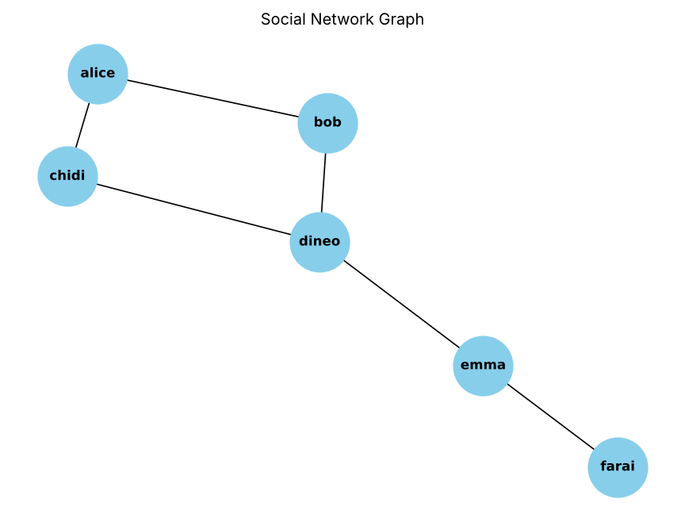

# Data Structures and Algorithms in Python: Task Scheduler & Social Media Manager


Two command-line Python applications that put core data structures to work: a **priority-based task scheduler** built on a min-heap, and a **social network analyser** built on an undirected graph.

## Academic context

This repository contains my project for the **Data Structures and Algorithms in Python (ITDPA2-44)** module, part of the BSc Information Technology (Data Science) programme at **Eduvos** (NQF Level 6). The project was an individual assessment worth 40% of the module mark.

The learning objectives were to:

- Implement data structures in Python.
- Select a suitable data structure or algorithm and justify the decision.

The original brief is included in [`docs/project_instructions.pdf`](docs/project_instructions.pdf).

## Projects

### Question 1: Task Scheduler (priority queue)

**Scenario:** Organise monthly academic tasks in order of importance, so the most important task is always retrieved first.

**Data structure choice: min-heap (`heapq`).** A heap gives O(log n) insertion and O(log n) removal of the highest-priority item, and O(1) peeking at it. A sorted list would cost O(n) per insertion, and an unsorted list would cost O(n) per retrieval. A heap is the natural fit for "always give me the most important item next".

| Component | Description |
|---|---|
| `Task` class | Stores description, due date, priority and estimated time. Implements `__lt__` so the heap orders by priority (1 = highest) and includes `print_info()`. |
| `Scheduler` class | `add_task`, `get_next_task`, `print_task_list`, `save_tasks` and `read_tasks` (JSON file persistence). |
| Main menu | Loops until the user chooses Exit. |

Run it: `python src/task_scheduler.py`

### Question 2: Social Media Manager (graph theory)

**Scenario:** Social platforms use network analysis to find patterns in how users connect. Each user is a **node** and each relationship is an **edge**.

**Data structure choice: undirected graph stored as an adjacency list** (a dictionary mapping each user to a list of their connections). Looking up a user's connections is fast, and storage grows with the number of connections rather than with the square of the number of users. Connections are mutual, so each one is stored in both directions.

| Component | Description |
|---|---|
| `ConnectionManager` class | `add_user`, `add_connection`, `view_all_users`, `view_all_connections` and `display_graph` (drawn with NetworkX and Matplotlib). |
| Main menu | Loops until the user chooses Exit. |

Run it: `python src/social_media_manager.py`

Example output of the **Display Graph** option:



## Repository structure

```
.
├── src/
│   ├── task_scheduler.py            # Question 1 as a runnable script
│   └── social_media_manager.py      # Question 2 as a runnable script
├── notebooks/
│   ├── q1_task_scheduler.ipynb      # Original Jupyter notebook, with sample runs
│   └── q2_social_media_manager.ipynb
├── docs/
│   └── project_instructions.pdf     # Original assessment brief
├── assets/
│   └── social_network_graph.png
├── requirements.txt
├── .gitignore
├── LICENSE
└── README.md
```

## Getting started

```bash
# 1. Clone the repository
git clone https://github.com/<your-username>/<repo-name>.git
cd <repo-name>

# 2. (Optional) create a virtual environment
python -m venv venv
source venv/bin/activate        # Windows: venv\Scripts\activate

# 3. Install dependencies (only Question 2 needs them)
pip install -r requirements.txt

# 4. Run either application
python src/task_scheduler.py
python src/social_media_manager.py
```

The `.ipynb` notebooks can be opened in Jupyter or Google Colab.

## Sample session (Task Scheduler)

```
===== Task Scheduler Menu =====
1. Add Task
2. View Next Task
3. View All Tasks
4. Save Tasks
5. Load Tasks
6. Exit
Enter your choice: 1
Enter task description: Study for exam
Enter due date (YYYY-MM-DD): 2026-11-30
Enter priority (1 = highest): 1
Enter estimated time (hours): 4
Task added successfully.
```

## Skills demonstrated

- Heaps and priority queues (`heapq`)
- Graph theory and adjacency lists
- Object-oriented programming (classes, encapsulation, operator overloading)
- File I/O and JSON serialisation
- Menu-driven CLI design
- Graph visualisation with NetworkX and Matplotlib
- Justifying data structure choices using time complexity

## Possible improvements

- Validate user input (non-numeric priority or time currently raises an error).
- Validate due dates with `datetime`, and use them to break priority ties.
- Write the saved task file in priority order.
- Add graph analysis such as degree centrality, shortest paths (BFS) and community detection.
- Add unit tests with `pytest`.

## Author

**Buhle Malinga**: BSc IT (Data Science), Eduvos
Portfolio: [ctrlalt-buhle.github.io/portfolio](https://ctrlalt-buhle.github.io/portfolio/)

## Licence

Released under the MIT Licence (see [`LICENSE`](LICENSE)). The assessment brief in `docs/` is the property of Eduvos and is included for context only.
